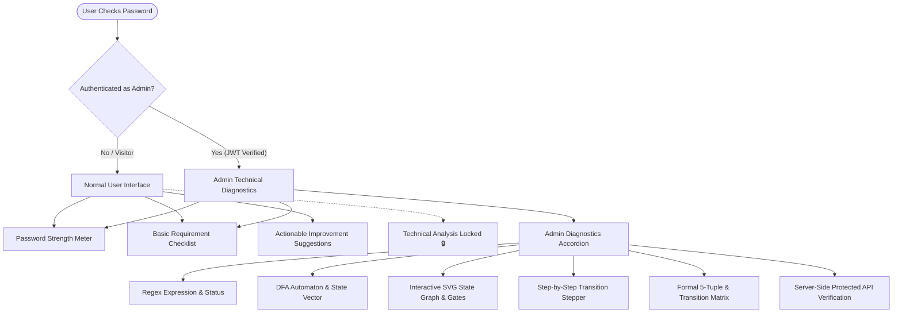
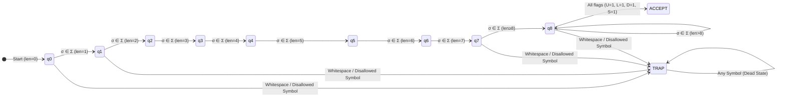

# SecurePass — Role-Based Password Policy Validation & Secure Authentication System

[](https://vitejs.dev/)
[](https://nodejs.org/)
[](https://www.mongodb.com/atlas)
[](https://www.npmjs.com/package/bcryptjs)
[-orange)](#)
[-blueviolet)](https://en.wikipedia.org/wiki/Deterministic_finite_automaton)

---

## 1. Project Overview

**SecurePass** is a full-stack cybersecurity and theoretical computer science web application. It demonstrates how formal language theory—specifically **Deterministic Finite Automata (DFA)** and **Regular Expressions (Regex)**—can be practically integrated with modern web authentication architecture (**React 19**, **Node.js/Express**, **MongoDB Atlas**, **JWT**, and **bcryptjs**) to enforce strict password policies and provide role-based access control (RBAC).

The system enforces a dual-tier user experience:
1. **Normal User Experience**: A clean, intuitive, non-technical interface providing instant password strength scoring, basic requirement feedback, and actionable improvement recommendations without exposing internal technical algorithms.
2. **Administrator Experience**: An advanced diagnostics environment allowing authenticated administrators to inspect DFA state progression, state transitions, formal 5-tuples, transition matrices, and Regular Expression evaluations.

---

## 2. Role-Based Access Control (RBAC) Architecture

SecurePass implements server-verified Role-Based Access Control to ensure technical automata details are strictly accessible to authorized administrators:



### RBAC Invariants:
- **Default User Role**: Every public user registration strictly receives the `user` role. Any `role` parameter supplied in the request body is discarded on the backend.
- **Server-Side Token Verification**: Administrative endpoints (`POST /api/auth/analyze`) require a valid JSON Web Token (JWT) and query MongoDB to verify that `user.role === 'admin'`. Unauthenticated calls yield `401 Unauthorized`, and normal users receive `403 Forbidden`.
- **Zero Frontend Vulnerability**: Normal users cannot access technical analysis by manipulating frontend state or directly calling backend endpoints.

---

## 3. Key Features

### Normal User Features:
- **Instant Strength Meter**: Classifies passwords into Weak, Medium, Strong, and Very Strong.
- **Basic Requirements Checklist**: Checks length, uppercase, lowercase, numbers, and special characters.
- **Actionable Recommendations**: Dynamic suggestions guide the user on exactly what characters to add.
- **Zero Technical Noise**: Hides regex strings, DFA states, transition histories, and debugging trees.

### Administrator Features:
- **Admin Diagnostics Panel**: Collapsible drawer with administrative badge and live diagnostics.
- **Regex Validation Inspection**: Live evaluation against strict regular expressions.
- **DFA Automaton Tracking**: Observes current state, path taken, and accept/trap conditions.
- **Interactive SVG State Machine**: Highlights length progression nodes ($q_0 \dots q_8$), condition gates ($U, L, D, S$), accept state ($F$), and trap state ($TRAP$).
- **Character Transition Stepper**: Clickable trace showing `fromState --[char]--> toState`.
- **Server API Verification**: Button to trigger live backend verification via protected `POST /api/auth/analyze`.

---

## 4. Technology Stack

| Layer | Technologies |
| :--- | :--- |
| **Frontend** | React 19, Vite 8, Modern CSS (Inter typography, CSS Variables, Flexbox/Grid, Responsive Design), SVG graphics |
| **Backend** | Node.js (v24), Express 5, CORS, Dotenv, jsonwebtoken (JWT) |
| **Database** | MongoDB Atlas (Cloud Cluster), Mongoose 9 |
| **Cryptography** | bcryptjs (10 salt rounds), JWT authentication |
| **Formal Language Theory** | Deterministic Finite Automaton (145 states product machine), Regular Expressions with positive lookaheads |
| **Testing** | Custom automated verification suite (76 unit, integration, and RBAC security tests) |

---

## 5. Password Policy Specification

A password $w \in \Sigma^*$ is valid if and only if it satisfies all 7 security constraints:

1. **Minimum Length**: At least 8 characters ($|w| \ge 8$).
2. **Uppercase Letter**: At least one character from $[A-Z]$.
3. **Lowercase Letter**: At least one character from $[a-z]$.
4. **Numeric Digit**: At least one character from $[0-9]$.
5. **Special Character**: At least one symbol from the permitted special character set ($\Sigma_{special}$).
6. **No Whitespace**: No space, tab, or newline characters ($w \cap \{\text{' '}, \text{'\t'}, \text{'\n'}, \text{'\r'}\} = \emptyset$).
7. **Only Permitted Characters**: All characters in $w$ must belong strictly to the defined alphabet $\Sigma$.

### Permitted Special Characters Set ($\Sigma_{special}$)
The 32 permitted special characters are:
```
! @ # $ % ^ & * ( ) _ + - = [ ] { } ; : ' , . < > / ?
```

---

## 6. Regular Expression Engine Explanation

### Regular Expression Pattern
```regex
/^(?=.*[A-Z])(?=.*[a-z])(?=.*[0-9])(?=.*[!@#$%^&*()_+\-=[\]{};:',.<>/?])[A-Za-z0-9!@#$%^&*()_+\-=[\]{};:',.<>/?]{8,}$/
```

### Breakdown of Regex Components:

| Pattern Component | Function & Role |
| :--- | :--- |
| `^` | Asserts the start of the string. |
| `(?=.*[A-Z])` | **Positive Lookahead**: Asserts that at least one uppercase letter exists ahead. |
| `(?=.*[a-z])` | **Positive Lookahead**: Asserts that at least one lowercase letter exists ahead. |
| `(?=.*[0-9])` | **Positive Lookahead**: Asserts that at least one numeric digit exists ahead. |
| `(?=.*[!@#$%^&*()_+\-=[\]{};:',.<>/?])` | **Positive Lookahead**: Asserts that at least one permitted special character exists ahead. |
| `[A-Za-z0-9!@#$%^&*()_+\-=[\]{};:',.<>/?]{8,}` | **Character Class Restriction & Length**: Enforces that **only** permitted characters are present (disallowing whitespace and illegal characters) and requires a minimum length of 8. |
| `$` | Asserts the end of the string. |

---

## 7. Deterministic Finite Automaton (DFA) Explanation

### Formal 5-Tuple Definition: $M = (Q, \Sigma, \delta, q_0, F)$

1. **Finite Set of States ($Q$)**:
   Product automaton tracking length ($0 \le k \le 8$) and a 4-bit condition vector $(u, l, d, s) \in \{0, 1\}^4$, plus an absorbing dead state:
   $$Q = (\{0, 1, 2, \dots, 8\} \times \{0, 1\}^4) \cup \{ q_{trap} \}$$
   $$\text{Total States: } |Q| = (9 \times 16) + 1 = 145 \text{ states}$$
2. **Alphabet ($\Sigma$)**:
   $$\Sigma = \Sigma_{upper} \cup \Sigma_{lower} \cup \Sigma_{digit} \cup \Sigma_{special} \quad (|\Sigma| = 94)$$
3. **Initial State ($q_0$)**:
   $$q_0 = \text{q0\_U0\_L0\_D0\_S0}$$
4. **Transition Function ($\delta: Q \times \Sigma \to Q$)**:
   $$\delta((k, u, l, d, s), c) = \begin{cases}
   (\min(k+1, 8), 1, l, d, s) & \text{if } c \in \Sigma_{upper} \\
   (\min(k+1, 8), u, 1, d, s) & \text{if } c \in \Sigma_{lower} \\
   (\min(k+1, 8), u, l, 1, s) & \text{if } c \in \Sigma_{digit} \\
   (\min(k+1, 8), u, l, d, 1) & \text{if } c \in \Sigma_{special} \\
   q_{trap} & \text{if } c \notin \Sigma \text{ or whitespace}
   \end{cases}$$
5. **Set of Accepting States ($F$)**:
   $$F = \{ \text{q8\_U1\_L1\_D1\_S1} \}$$

---

### DFA State Transition Diagram (Mermaid)



---

## 8. Installation and Setup Instructions

### Prerequisites
- **Node.js** (v18.0.0 or higher, v24+ recommended)
- **npm** (v9.0.0 or higher)
- **MongoDB Atlas** database URI

---

### Step 1: Clone Repository
```bash
git clone https://github.com/<your-username>/SecurePass.git
cd SecurePass
```

---

### Step 2: Backend Configuration
1. Navigate to `backend`:
   ```bash
   cd backend
   npm install
   ```
2. Verify or configure your `.env` file in `backend/.env`:
   ```env
   PORT=5001
   MONGO_URI=mongodb+srv://<username>:<password>@<cluster>.mongodb.net/securepass?retryWrites=true&w=majority
   JWT_SECRET=your_jwt_secret_key_here
   ADMIN_EMAIL=admin@securepass.local
   ADMIN_PASSWORD=AdminSecurePass2026!
   ADMIN_NAME=System Administrator
   ```
   *(Note: The administrator account is automatically initialized in MongoDB upon backend startup).*

3. Run the automated test suite to verify MongoDB connectivity, DFA/Regex logic, and RBAC:
   ```bash
   npm test
   ```

4. Start the backend server:
   ```bash
   npm run dev
   ```
   *Server runs at `http://localhost:5001`.*

---

### Step 3: Frontend Configuration
1. In a second terminal, navigate to `frontend`:
   ```bash
   cd frontend
   npm install
   ```
2. Start the Vite development server:
   ```bash
   npm run dev
   ```
   *Frontend runs at `http://localhost:5174`.*

---

## 9. REST API Endpoints & Role Permissions

| Method | Endpoint | Description | Role Required |
| :--- | :--- | :--- | :---: |
| `GET` | `/api/health` | Health check & MongoDB Atlas status | Public |
| `POST` | `/api/auth/check` | Simple, user-friendly password evaluation (checks password alone) | Public |
| `POST` | `/api/auth/register` | Register user (strictly assigned `user` role) | Public |
| `POST` | `/api/auth/user-login` | Dedicated Client User Login (checks password alone, zero technical jargon) | Public |
| `POST` | `/api/auth/admin-login` | Dedicated Company Administrator Login (unlocks technical diagnostics) | Public (Admin Creds) |
| `POST` | `/api/auth/login` | Unified authentication endpoint | Public |
| `GET` | `/api/auth/me` | Fetch active user session profile | Authenticated |
| `POST` | `/api/auth/analyze` | Company technical DFA & Regex diagnostics | **Admin Only** |

---

## 10. Test Execution Summary

The automated test suite (`backend/test_suite.js`) runs **80 comprehensive assertions**:

| Category | Tests Executed | Passed | Failed | Success Rate |
| :--- | :---: | :---: | :---: | :---: |
| Regex & DFA Policy Agreement | 26 | 26 | 0 | 100% |
| Permitted Special Characters Coverage | 32 | 32 | 0 | 100% |
| MongoDB Atlas Connection & Admin Init | 2 | 2 | 0 | 100% |
| Role Invariance during Registration | 2 | 2 | 0 | 100% |
| Normal User Output Sanitization (Zero Tech Leak) | 7 | 7 | 0 | 100% |
| RBAC Backend Security (401 & 403 enforcement) | 5 | 5 | 0 | 100% |
| Admin Technical Analysis Payload Verification | 2 | 2 | 0 | 100% |
| Separate User Login vs Admin Login Portals | 4 | 4 | 0 | 100% |
| **TOTAL** | **80** | **80** | **0** | **100%** |

---

## 11. Academic Documentation

For deeper theoretical study and evaluation, refer to the documentation files in the `docs/` folder:
- [DFA Formal Specification](file:///d:/FSWD/SecurePass/docs/DFA_FORMAL_SPECIFICATION.md): Mathematical 5-tuple formulation, product automaton construction, and formal language proofs.
- [REST API Documentation](file:///d:/FSWD/SecurePass/docs/API_DOCUMENTATION.md): Detailed API contract, request/response payloads, and error codes.
- [Testing & Verification Report](file:///d:/FSWD/SecurePass/docs/TESTING_AND_VERIFICATION.md): Execution logs of all 76 automated test cases and security invariants.

---

## 12. License
This project is developed for academic demonstration and research purposes under the **ISC License**.
